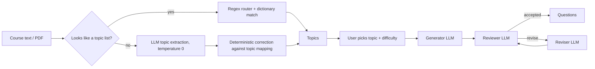

# AI Question Generator

Turns course material into practice exams. Give it a syllabus or lecture text, pick one of the topics it finds and a difficulty, and it returns reviewed practice questions for that topic.

> Status: in progress. Topic extraction is exposed through a FastAPI endpoint; the question-generation loop currently runs as a script (`tests/test_generation.py`).

## How it works



### 1. Topic extraction

- **Regex router.** If the input already looks like a list of topics (one per line, or separated by `;` `/` `|`), it is split with regex, aliases are normalized, and each item is matched against a dictionary of **979 specific topics mapped to 43 general areas**. No LLM call is made on this path.
- **LLM path.** Free text goes to the LLM at temperature 0, which returns `specific_topics` and `general_topics`. The output is then corrected deterministically: aliases are normalized and any topic the model put in the wrong category is moved using the topic mapping.

### 2. Question generation (generator → reviewer → reviser)

- **Generator** writes the questions for the chosen topic. Temperature depends on difficulty (easy 0.3, medium 0.5, hard 0.7).
- **Reviewer** is an LLM judge with a 7-point rubric: JSON format, required structure, topic alignment, difficulty alignment, logical correctness, clarity and overall quality. It returns `accepted`, `revise` or `rejected` plus a list of concrete issues.
- **Reviser** rewrites the questions from the reviewer's issues, and the new version is reviewed again.
- The loop runs for at most **3 review rounds**:
  - `accepted` → questions are returned (`approved: true`).
  - still `revise` after 3 rounds → the latest version is returned, marked `approved: false` with the open issues.
  - still `rejected` after 3 rounds → nothing is shown; a `QuestionsRejectedError` is raised.
- Each request is also capped by total LLM calls and total seconds (`config/llm_steps.json` → `pipeline`); hitting a cap raises `RequestBudgetExceededError` with a user-facing message.

### LLM gateway, config and traces

- Every text LLM call goes through `llm_client.call_llm`: per-call timeout, retry with exponential backoff + jitter on 429 / 5xx / timeouts (no retry on other 4xx), and a log line with step, model, temperature, tokens and duration.
- Model, temperature, timeout and retry settings per step (`topic_extraction`, `generator`, `reviewer`, `reviser`) live in `config/llm_steps.json`. Changing a model is a config change.
- Each question-generation request writes `traces/<trace_id>.jsonl`: the request, each step's output, parse result, reviewer status and issues per round, and the final result. The `trace_id` is returned with the questions.

## Project structure

```
app_main.py                     FastAPI app
api_router.py                   POST /api/v1/analyze-pdf
llm_client.py                   LLM gateway (Groq, OpenAI-compatible API): timeout, retry, logging
config/llm_steps.json           Per-step model / temperature / retry settings and request limits
services/
  pdf_service.py                PDF → text (text extraction / OCR / vision fallback)
  generation_request.py         Validates topic + difficulty into a generation request
  question_pipeline.py          Generator → reviewer → reviser loop
  trace.py                      Per-request JSONL trace
prompts/
  topic_prompt.py               Topic extraction prompt
  question_generator.py         Generator prompt
  reviewer.py                   Reviewer rubric prompt
  revision_generator.py         Reviser prompt
tools/
  topic_extractor/              Regex router, dictionary matching, LLM extraction
  normalazation/                Topic / JSON normalization helpers
topics/                         Topic dictionary, mapping, aliases, topic tree
tests/
  test_generation.py            Manual run of the question pipeline
  test_llm_client.py            Offline tests: retry, config, trace, request limits
```

## Setup

1. Create a `.env` file in the project root:
   ```
   GROQ_API_KEY=your_key_here
   ```
2. Install dependencies:
   ```bash
   pip install -r requirements.txt
   ```
   OCR additionally needs `tesseract-ocr` and `poppler-utils` installed on the system (the Dockerfile installs them).

## Run

**API (topic extraction from a PDF):**
```bash
uvicorn app_main:app --reload
# then POST a PDF to http://localhost:8000/api/v1/analyze-pdf
```

**With Docker:**
```bash
docker compose up --build
```

**Question generation loop:**
```bash
python3 -m tests.test_generation
```

**Offline tests (no API key needed):**
```bash
python3 -m pytest tests/test_llm_client.py
```

**Topic extraction only:**
```bash
python3 main.py
```

## Known limitations

- Topic names must match the dictionary or an alias; e.g. "Kruskal" needs an alias to "Minimum Spanning Tree Kruskal" (see `tests/test_results.md`).
- LLM output formats are requested in the prompt and parsed manually; schema-enforced structured output would make this more reliable.
- The reviewer uses the same model as the generator, so it can share the generator's blind spots.
- Questions are generated without answer keys, which limits how well correctness can be checked.

## Contributors

- **Ali Yakub Atlı:** topic extraction (regex router, LLM path, alias and category correction), question generation and review pipeline
- **Mehmet Eren Günaydın:** PDF ingestion (OCR, vision fallback), Docker setup
